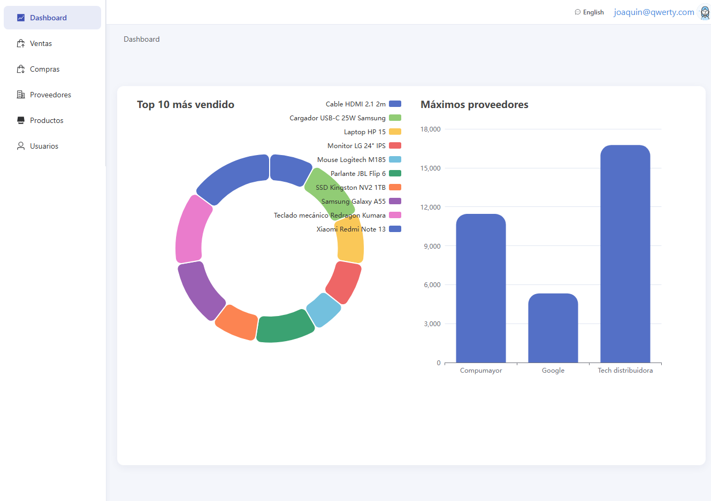
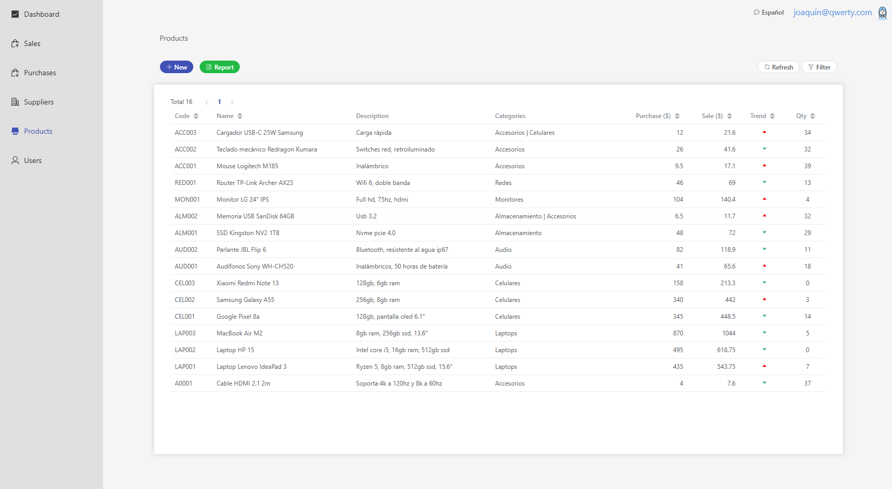
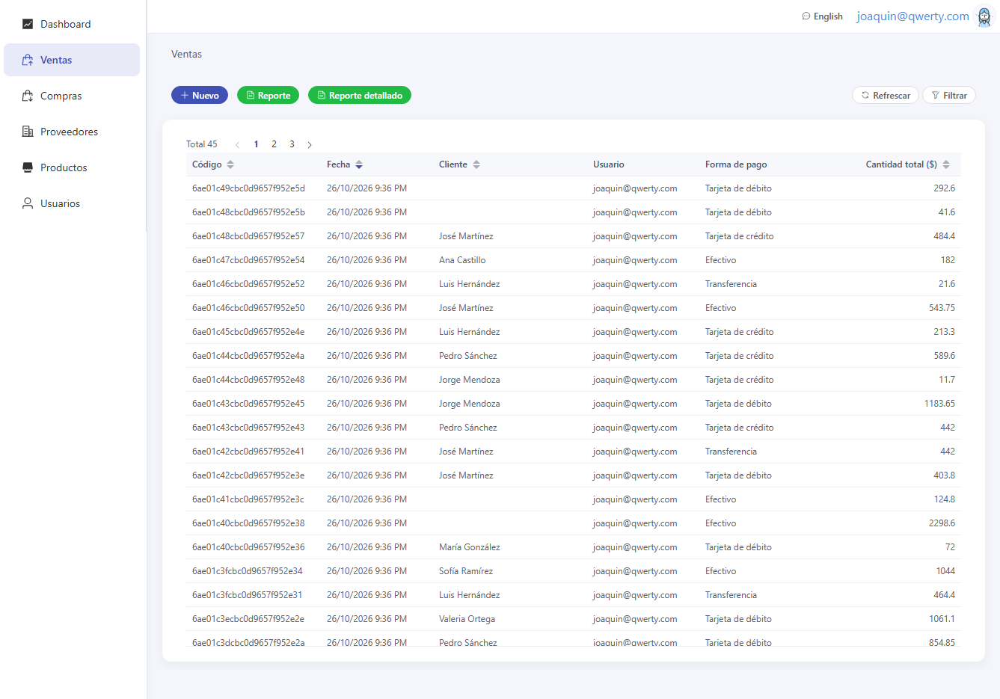

# 📦 Sistema de Inventario | Inventory System

🚀 _Aplicación web para gestionar el inventario, compras y ventas de una tienda, con dashboard, reportes y recibos._
🚀 _Web app to manage a store's inventory, purchases and sales, with dashboard, reports and receipts._

📌 **Enlace a la demo | Live demo link:** [🔗 Ver en Vivo | View Live](https://inventory-ni.netlify.app)

---

## 🎯 Sobre este Proyecto | About this Project

### Español:

Este proyecto nació como un sistema de inventario para pequeñas tiendas, desarrollado en colaboración con [ErickRuiz97](https://github.com/ErickRuiz97) y [jonathan-code-95](https://github.com/jonathan-code-95). Permite registrar productos, proveedores, compras y ventas, controlando el stock y la evolución de precios en tiempo real, con acceso según el rol de cada usuario.

El frontend está construido con **Vue 3** y **Element Plus**, y consume una API construida con **FastAPI** y **MongoDB**. ([🔗 Ver repositorio](https://github.com/joaquinn6/inventory-api))

_¡Este proyecto no es solo una carta de presentación, sino una muestra real de mis habilidades como desarrollador full-stack!_

### English:

This project was born as an inventory system for small stores, developed in collaboration with [ErickRuiz97](https://github.com/ErickRuiz97) and [jonathan-code-95](https://github.com/jonathan-code-95). It records products, suppliers, purchases and sales, tracking stock and price evolution in real time, with access based on each user's role.

The frontend is built with **Vue 3** and **Element Plus**, and consumes an API built with **FastAPI** and **MongoDB**. ([🔗 View repository](https://github.com/joaquinn6/inventory-api))

_This project is not just a presentation letter, but a real showcase of my skills as a full-stack developer!_

---

## 🎥 Vista Previa | Preview

📸 
📸 
📸 

---

## ✨ Características Principales | Key Features

### Español:
✅ **Inicio de sesión** con JWT y rutas protegidas por rol (`ADMIN`, `MANAGER`, `SALES`).
✅ **Dashboard** con gráficos (ECharts) de los productos más vendidos y los proveedores con mayor gasto.
✅ **Productos**: listado con filtros y paginación, categorías, garantía y gráfico del historial de precios.
✅ **Compras**: selección de productos, actualización de precios y stock.
✅ **Ventas**: registro con validación de stock y descarga del **recibo en PDF**.
✅ **Proveedores y usuarios**: gestión completa, activación/desactivación y cambio de contraseña.
✅ **Exportación a Excel** de todos los listados.
✅ **Configuración de la empresa**: logo, datos, moneda, categorías y código autogenerado de productos.
✅ **Respaldo y restauración** de la base de datos desde la interfaz.
✅ **Interfaz en español e inglés**, que recuerda el idioma elegido e incluye los textos de Element Plus.
✅ **Diseño responsivo** con menú lateral (drawer).
✅ **Botones de usuarios de prueba** en el login y aviso mientras la API gratuita despierta.

### English:
✅ **Login** with JWT and role-protected routes (`ADMIN`, `MANAGER`, `SALES`).
✅ **Dashboard** with charts (ECharts) of best-selling products and top-spend suppliers.
✅ **Products**: filtered, paginated listing, categories, warranty and price-history chart.
✅ **Purchases**: product selection, price and stock updates.
✅ **Sales**: registration with stock validation and **PDF receipt** download.
✅ **Suppliers and users**: full management, activation/deactivation and password change.
✅ **Excel export** for every listing.
✅ **Company settings**: logo, details, currency, categories and auto-generated product codes.
✅ Database **backup and restore** from the UI.
✅ **Spanish and English UI** that remembers the chosen language and includes Element Plus texts.
✅ **Responsive design** with a side drawer menu.
✅ **Test user buttons** on the login, plus a notice while the free API wakes up.

---

## 🛠 Tecnologías Utilizadas | Technologies Used

#### **Frontend:**
- Vue 3 + Vite
- Pinia (gestión de estado global | state management)
- Vue Router (navegación | navigation)
- Element Plus + Bootstrap (UI)
- ECharts / vue-echarts (gráficos | charts)
- Vue I18n (español e inglés | Spanish and English)
- Axios (consumo de API | API consumption)
- Moment (control de fechas | date control)
- SASS, ESLint, Prettier

### **Backend:**
- FastAPI ([🔗 Ver repositorio](https://github.com/joaquinn6/inventory-api))
- MongoDB

### **Despliegue | Deployment:**
- **Frontend:** Netlify
- **Backend:** Render

---

## 🚀 Ejecución local | Running locally

### Requisitos | Requirements
- Node **22.11** (se recomienda [nvm](https://github.com/nvm-sh/nvm) | [nvm](https://github.com/nvm-sh/nvm) recommended)
- API corriendo localmente | API running locally ([inventory-api](https://github.com/joaquinn6/inventory-api))

### Variables de entorno | Environment variables

Crear un archivo `.env` en la raíz | Create a `.env` file at the root:

```env
VITE_API_URI=http://localhost:8000
# Opcional: muestra en el login los botones de usuarios de prueba | Optional: shows the test user buttons on the login
VITE_DEMO_PASSWORD=
```

### Comandos | Commands

```bash
npm install       # Instalar dependencias | Install dependencies
npm run dev       # Servidor de desarrollo | Dev server (http://localhost:5173)
npm run build     # Build de producción | Production build
npm run preview   # Previsualizar el build | Preview the build
npm run lint      # ESLint
npm run format    # Prettier
```

---

## 👥 Colaboradores | Contributors

- [Joaquín Núñez Vega](https://github.com/joaquinn6)
- [ErickRuiz97](https://github.com/ErickRuiz97)
- [jonathan-code-95](https://github.com/jonathan-code-95)

---

## 📬 Contacto | Contact

- **📧 Email:** joaquin.software.e@gmail.com
- **💼 LinkedIn:** [Mi LinkedIn](https://www.linkedin.com/in/joaquin-n6/)
- **🐙 GitHub:** [Mi GitHub](https://github.com/joaquinn6)

---

## 📜 Licencia | License
### Español:
📄 Este proyecto está bajo la licencia **MIT**. Siéntete libre de usarlo, modificarlo y compartirlo.

### English:
This project is licensed under the **MIT** license. Feel free to use, modify, and share.
